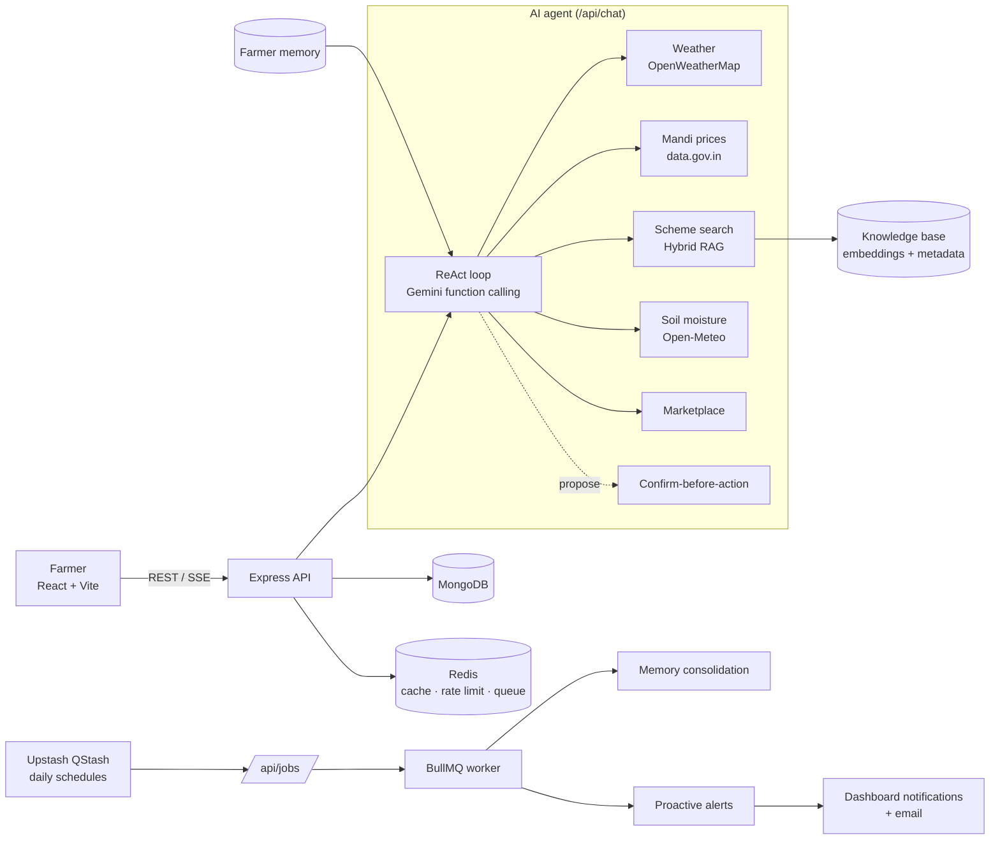

# 🌾 Krishak Sahayak

**An AI-powered agri-tech platform for Indian farmers** — live weather, mandi prices, government schemes and an agro-products marketplace, with a bilingual (Hindi/English) **AI agent** that checks live data before it answers, remembers each farmer's farm, and sends proactive alerts.

[Live demo](https://krishakshayak.duckdns.org/) · [AI agent guide](backend/AI_AGENT.md)

---

## Contents

- [Features](#features)
- [The AI agent](#the-ai-agent)
- [Architecture](#architecture)
- [Tech stack](#tech-stack)
- [Getting started](#getting-started)
- [Environment variables](#environment-variables)
- [Scripts](#scripts)
- [API overview](#api-overview)
- [Evaluation](#evaluation)
- [Project structure](#project-structure)
- [Deployment](#deployment)

---

## Features

| Area | What farmers get |
|---|---|
| **AI farm assistant** | Ask in Hindi or English. Answers to questions like *"should I sell my wheat this week?"* use live prices, the forecast and verified scheme data. |
| **Weather** | Current conditions, hourly and 5-day forecast, soil moisture, and AI tips for the day's field work. |
| **Mandi prices** | Daily commodity prices from the government Agmarknet feed (data.gov.in), filtered by state, district, market and crop. |
| **Government schemes** | Searchable catalogue of central and state schemes, with eligibility, benefits and official links. |
| **Marketplace** | Buy seeds, fertiliser, tools and equipment; sellers manage shops, products and orders. Includes a secure payment gateway. |
| **Farm memory** | *My Farm Memory* page showing what the assistant remembers (crops, district, farm diary). Everything can be edited or deleted. |
| **Proactive alerts** | Daily alerts, e.g. rain before a planned spray, frost risk, or big price moves for your crops. |
| **Accounts & security** | JWT and Google OAuth login, email OTP two-factor authentication, password reset, and Redis token-bucket rate limiting. |
| **Health dashboard** | Service health and AWS CloudWatch metrics. |

---

## The AI agent

The assistant is an **agent**, not a plain chatbot. Full design notes are in [`backend/AI_AGENT.md`](backend/AI_AGENT.md).

- **Tool calling, ReAct-style.** Gemini works in a loop: decide what's needed → call tools (in parallel) → read the results → answer. The tools are:
  - weather forecast (OpenWeatherMap)
  - mandi prices (Agmarknet)
  - scheme search
  - soil moisture (Open-Meteo)
  - marketplace search
- **Streaming (SSE).** Farmers see progress such as *"Checking mandi prices…"* while the answer streams in.
- **Human confirmation.** Actions like *add to cart* or *save to farm diary* are only proposed. They run after the farmer taps **Confirm**, and the server checks a signed token first.
- **Hybrid RAG.** Scheme answers come from retrieval, never from memory:
  - BM25 keyword search plus **vector embeddings**
  - **metadata filters** (state, topic)
  - **Reciprocal Rank Fusion** to merge the two result lists
  - **LLM reranking**
  - Duplicate catalogue entries are merged into one.
- **Long-term memory.**
  - *Semantic* memory holds the farm profile (crops, district, land, irrigation).
  - *Episodic* memory is the farm diary (e.g. "sprayed insecticide 2 days ago").
  - Facts are extracted after each chat, with personal identifiers filtered out, and used to personalise answers.
- **Background jobs.** **BullMQ on Redis** runs nightly memory consolidation and morning **proactive alerts**. On free hosting the jobs are triggered by **Upstash QStash**, and each request's signature is verified.
- **Evaluation.**
  - 40 bilingual test questions and 4 simulated farmer personas.
  - **LLM-as-a-Judge** scoring.
  - **Ablations**: baseline vs agent vs agent + RAG vs agent + RAG + memory.

Everything runs on **free tiers**: the Gemini API (Flash, Flash-Lite, Embedding), the MongoDB Atlas free cluster, Upstash QStash, and Redis (Render free Key Value or self-hosted).

---

## Architecture



---

## Tech stack

| Layer | Technologies |
|---|---|
| Frontend | React 19, Vite, Tailwind CSS, React Router, i18next (English / हिन्दी) |
| Backend | Node.js, Express, Mongoose |
| Database & cache | MongoDB (Atlas), Redis (ioredis) |
| AI | Google Gemini API (`@google/genai`): function calling, structured output, embeddings |
| Jobs | BullMQ, Upstash QStash |
| External data | OpenWeatherMap, data.gov.in Agmarknet, Open-Meteo, Google Sheets (scheme catalogue) |
| Auth | JWT, Google OAuth 2.0, email OTP (Nodemailer) |
| DevOps | GitHub Actions, AWS EC2 + PM2, AWS CloudFormation & CDK (monitoring), CloudWatch |

---

## Getting started

### Prerequisites

- Node.js 20 or newer
- MongoDB: local, or a free [Atlas](https://www.mongodb.com/atlas) cluster
- Redis: local, or any hosted Redis URL. *Optional*: without it the app skips caching and runs jobs inline.
- A free [Gemini API key](https://aistudio.google.com/apikey) and an [OpenWeatherMap](https://openweathermap.org/api) key

### 1. Clone

```bash
git clone https://github.com/Utkarsh-Srivastava29/Krishak-Shayak.git
cd Krishak-Shayak
```

### 2. Backend

```bash
cd backend
npm install
cp .env.example .env        # fill in the values (see below)
npm run rag:ingest          # build the scheme knowledge base (embeddings)
npm run dev                 # http://localhost:5000
```

### 3. Frontend

```bash
cd frontend
npm install
cp .env.example .env        # set VITE_API_URL=http://localhost:5000/api
npm run dev                 # http://localhost:5173
```

### 4. Check it works

```bash
cd backend
npm run test:ai             # 36 unit tests for the agent, RAG, memory, jobs and alerts
```

Open the app, click **Ask Krishak Sahayak**, and try *"Will it rain in Etawah this week?"*.

---

## Environment variables

The full list, with comments, is in [`backend/.env.example`](backend/.env.example) and [`frontend/.env.example`](frontend/.env.example).

**Backend: required**

| Variable | Purpose |
|---|---|
| `MONGODB_URI` | MongoDB connection string |
| `JWT_SECRET` | Signs login tokens (and agent action tokens) |
| `GEMINI_API_KEY` | AI assistant, embeddings, memory, evaluation |
| `OPENWEATHER_API_KEY` | Weather data |
| `FRONTEND_URL` | Allowed CORS origin |

**Backend: optional**

| Variable | Purpose |
|---|---|
| `REDIS_URL` | Caching, rate limiting, BullMQ queue |
| `DATA_GOV_API_KEY` | Mandi prices (a public demo key is used by default) |
| `SCHEMES_SHEET_URL` | Live scheme catalogue (Google Sheets CSV); the bundled copy is used otherwise |
| `VECTOR_SEARCH_MODE` | `local` (default) or `atlas` for MongoDB Atlas `$vectorSearch` |
| `JOB_SCHEDULER` | `qstash` (hosts that sleep) or `bullmq` (always-on servers) |
| `QSTASH_TOKEN`, `QSTASH_CURRENT_SIGNING_KEY`, `QSTASH_NEXT_SIGNING_KEY`, `PUBLIC_API_URL` | Scheduled jobs through Upstash QStash |
| `ALERT_EMAILS_ENABLED` | Also email daily alerts (uses the `EMAIL_*` SMTP settings) |
| `GOOGLE_CLIENT_ID`, `GOOGLE_CLIENT_SECRET`, `EMAIL_*` | Google login and email OTP |

---

## Scripts

Run these from `backend/`:

| Command | What it does |
|---|---|
| `npm run dev` / `npm start` | Start the API (with nodemon / plain node) |
| `npm run test:ai` | Unit tests for the AI features. They need no network or API keys. |
| `npm test` | Auth and 2FA security tests (needs Redis) |
| `npm run rag:ingest` | Embed the scheme catalogue into MongoDB. Add `-- --force` to re-embed everything. |
| `npm run jobs:schedule` | Create the two daily Upstash QStash schedules |
| `npm run eval` | Run the agent evaluation (see below) |

Run these from `frontend/`: `npm run dev`, `npm run build`, `npm run preview`, `npm run lint`.

---

## API overview

| Route | Description |
|---|---|
| `POST /api/chat` | AI agent; streams Server-Sent Events. Works for guests; memory requires sign-in. |
| `POST /api/chat/actions/confirm` | Run an action the farmer confirmed |
| `GET/POST/PATCH/DELETE /api/memory` | View and manage what the assistant remembers |
| `GET /api/notifications` | Proactive alerts for the signed-in farmer |
| `POST /api/jobs/:name` | Scheduled job trigger (QStash-signed requests only) |
| `GET /api/weather`, `/hourly`, `/insights` | Weather, forecast and AI field tips |
| `GET /api/market-prices` | Mandi prices |
| `GET /api/schemes` | Government schemes |
| `/api/products`, `/api/orders`, `/api/seller` | Marketplace |
| `/api/auth`, `/api/users` | Accounts, OAuth, OTP, profile |
| `GET /api/health` | Service health and metrics |

---

## Evaluation

```bash
cd backend
npm run eval -- --limit 10                          # quick run
npm run eval                                        # 40 questions × 4 systems
npm run eval -- --sim                               # + multi-turn persona simulations
```

**Setups compared:**

| System | Tools | Retrieval | Memory |
|---|---|---|---|
| Baseline | none (whole catalogue in the prompt) | none | no |
| Agent | all | keyword (BM25) | no |
| Agent + RAG | all | hybrid + rerank | no |
| Agent + RAG + memory | all | hybrid + rerank | yes |

**What's measured:**
- **Rule-based checks:** tool recall and keyword hit.
- **LLM-as-a-Judge** scores (1–5): correctness, groundedness, personalisation, helpfulness, plus a hallucination flag.
- **Persona simulations:** goal achieved, and how often the assistant re-asks details it should already know.

Live APIs are replaced with fixed test data, so runs are repeatable and need only `GEMINI_API_KEY`. Calls are throttled to stay inside the Gemini free tier, and results are saved after each answer (`--resume` continues a run). The report is written to `backend/eval/results/*.md`.

---

## Project structure

```
Krishak-Shayak/
├── backend/
│   ├── agent/          # ReAct loop, tools, prompts, signed action tokens
│   ├── rag/            # knowledge source, BM25, embeddings, fusion, reranker, retriever
│   ├── memory/         # extraction, merge rules, consolidation
│   ├── alerts/         # alert rules, price history, alert service
│   ├── jobs/           # BullMQ queue/worker, job processors, QStash verification
│   ├── eval/           # evaluation: queries, personas, fixtures, judge, simulator, report
│   ├── controllers/    # route handlers
│   ├── routes/         # Express routers
│   ├── models/         # Mongoose models (User, Product, Order, FarmerMemory, …)
│   ├── services/       # weather, mandi prices, schemes, email, OTP, Gemini client
│   ├── middleware/     # auth, caching, rate limiting
│   ├── scripts/        # rag:ingest, jobs:schedule
│   ├── tests/          # security tests + tests/ai unit tests
│   └── AI_AGENT.md     # AI design and setup guide
└── frontend/
    └── src/
        ├── components/ # AssistantChatbot, FarmAlerts, Navbar, marketplace UI…
        ├── pages/      # Home, Weather, MarketPrice, GovtSchemes, Marketplace, FarmMemory…
        ├── services/   # API clients (chat SSE, memory, marketplace, auth…)
        └── i18n/       # English and Hindi translations
```

---

## Deployment

- **Current setup:** GitHub Actions deploys `backend/` and `frontend/` to **AWS EC2** on every push to `main`. The backend runs under **PM2**. AWS infrastructure and the CloudWatch monitoring stack are deployed with CloudFormation and CDK workflows.
- **Free-hosting alternative:** frontend on **Vercel** (`frontend/vercel.json`), backend on **Render** free tier.
  - Render sleeps when idle, so set `JOB_SCHEDULER=qstash` and run `npm run jobs:schedule` once. QStash then wakes the server for the daily jobs.
  - On an always-on server (EC2), use `JOB_SCHEDULER=bullmq` instead.
- **After deploying the AI features:** run `npm run rag:ingest` once against the production database.

---

## Author

**Utkarsh Srivastava** · [GitHub](https://github.com/Utkarsh-Srivastava29)
